# Uptime Monitor

Aplikasi pemantauan server & situs web **self-hosted** — alternatif open-source untuk UptimeRobot yang bisa Anda jalankan sepenuhnya di infrastruktur Anda sendiri, tanpa data yang mengalir ke pihak ketiga.

## UI Interface

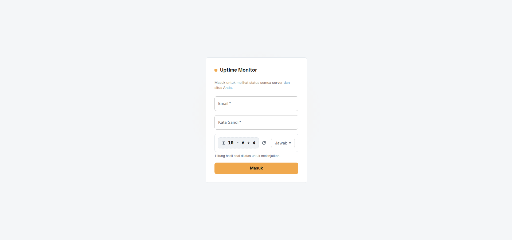

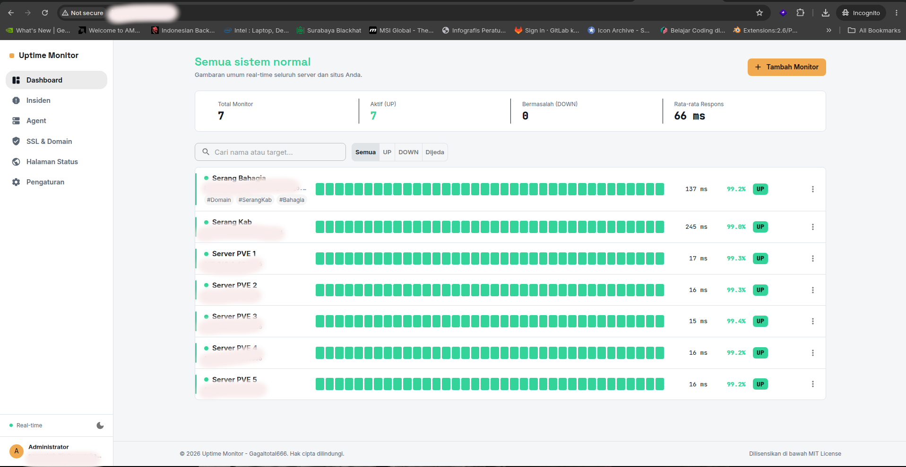

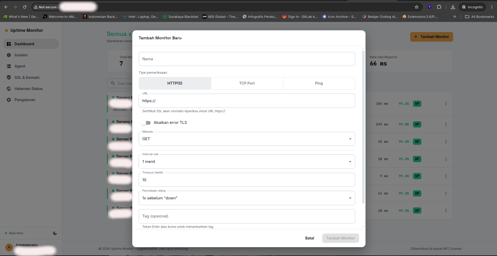

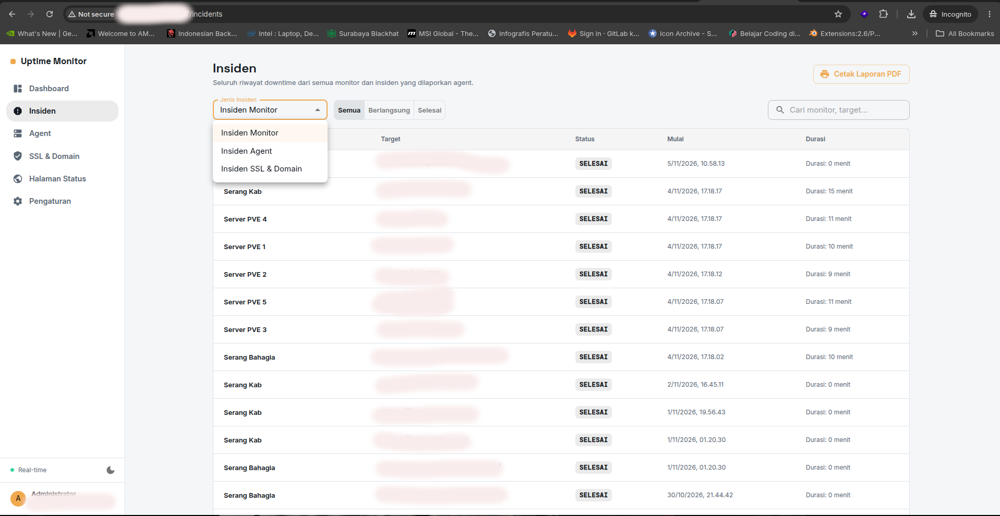

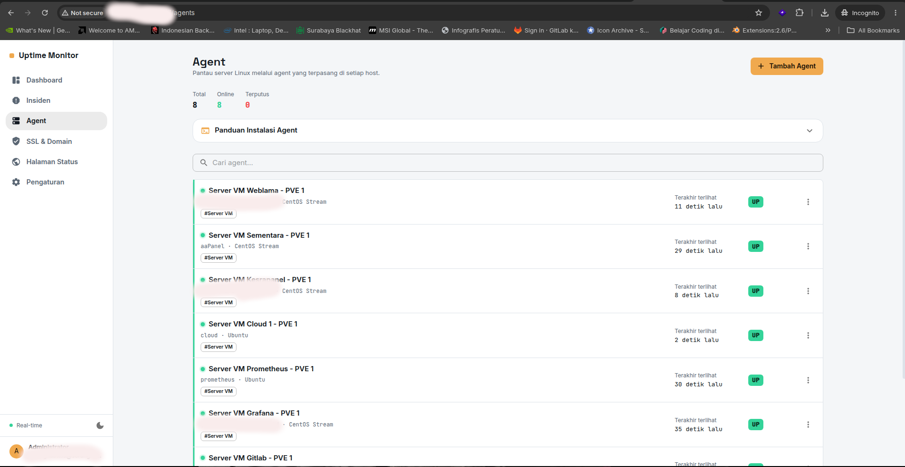

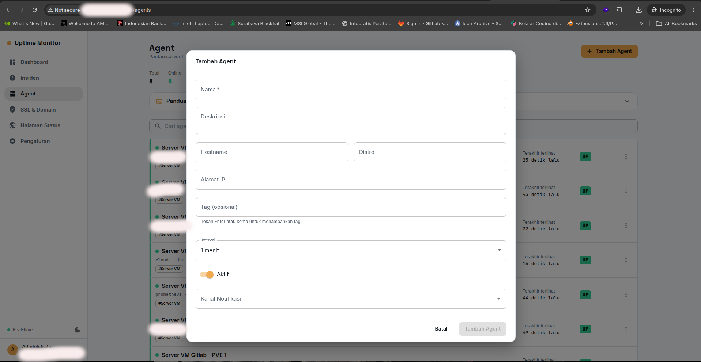

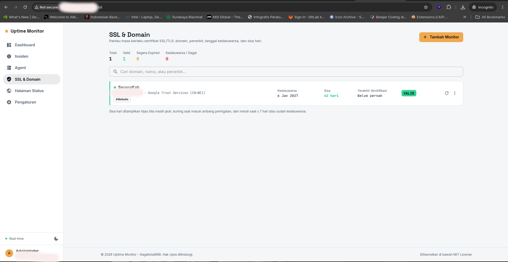

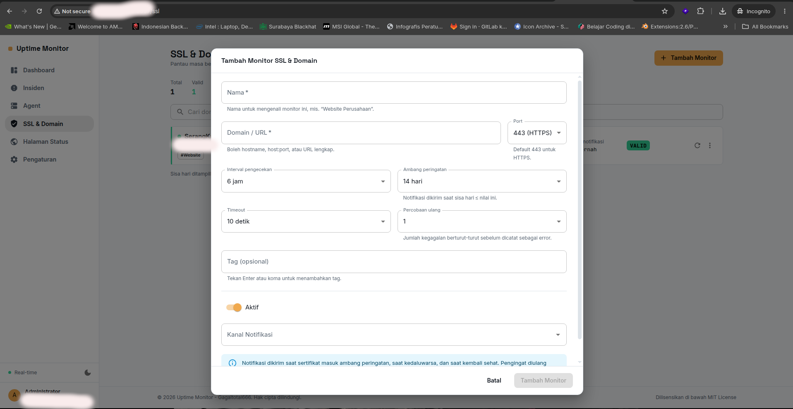

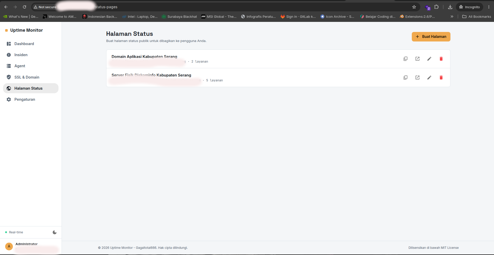

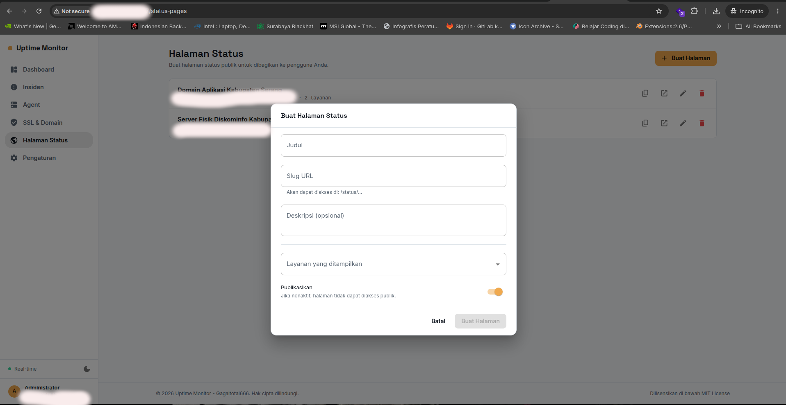

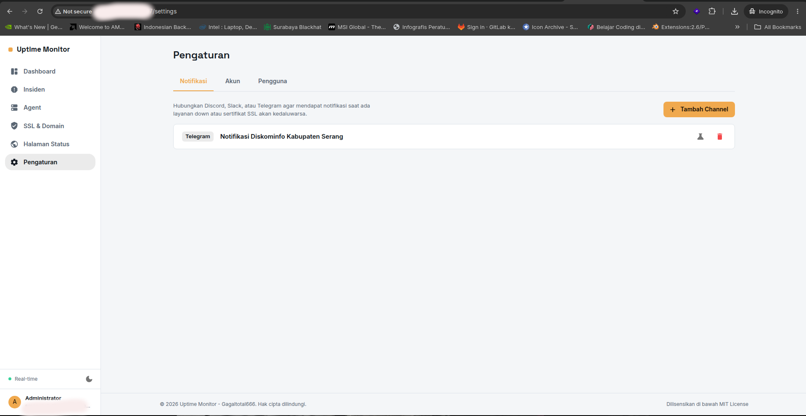

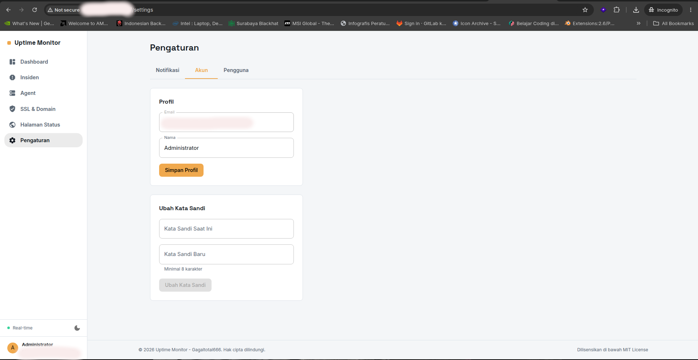

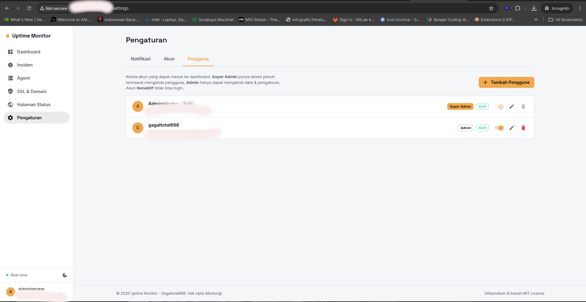

## Fitur

- **Dashboard real-time** — gambaran umum seluruh monitor, terhubung lewat WebSocket sehingga status ter-update tanpa refresh.
- **Tiga jenis pengecekan**: HTTP(S), TCP port, dan ICMP ping.
- **Pemantauan sertifikat SSL** otomatis untuk setiap monitor HTTPS, lengkap dengan peringatan sebelum kedaluwarsa.
- **SSL & Domain Monitoring** — pemantauan khusus sertifikat TLS yang berdiri sendiri: domain, penerbit (issuer), tanggal kedaluwarsa, sisa hari, status, dan waktu notifikasi terakhir. Punya menu sendiri, tercatat sebagai insiden, dan bisa mengirim notifikasi. Cocok untuk memantau domain yang sertifikatnya perlu diperpanjang berkala. Lihat bagian [SSL & Domain Monitoring](#ssl--domain-monitoring).
- **Riwayat uptime/downtime & waktu respons**, divisualisasikan dalam grafik.
- **Deteksi insiden otomatis** — setiap kali layanan down, insiden tercatat lengkap dengan durasi.
- **Notifikasi Discord, Slack & Telegram** saat layanan down, pulih kembali, atau SSL akan kedaluwarsa.
- **Halaman status publik** yang bisa dibuat dan dibagikan ke pengguna Anda (`/status/nama-halaman`).
- **Manajemen pengguna berperan (role)** — dua tingkat akses: **Super Admin** (akses penuh, termasuk mengelola pengguna) dan **Admin** (mengelola monitor & pengaturan, tanpa manajemen pengguna). Setiap akun juga punya status **Aktif/Nonaktif** yang bisa diubah kapan saja. Lihat bagian [Peran & Status Pengguna](#peran--status-pengguna).
- **Pemantauan melalui Agent** — pasang agen di server Anda dan dapatkan detail CPU, memori, disk, jaringan, proses, dan uptime host secara real-time. Bisa digunakan untuk memantau host yang tidak bisa diakses dari luar (di balik NAT/firewall).
- **Pemantauan service Linux** — agent mendeteksi service systemd/OpenRC yang gagal (`failed`/`crashed`) dan menampilkan namanya di halaman detail agent, serta membuat insiden otomatis.
- **Panduan instalasi Agent di dashboard** — langkah instalasi lengkap dan tombol unduh file agent langsung dari menu Agent.
- **Cetak laporan insiden PDF** — laporan insiden yang rapi (format A4) dapat dicetak atau disimpan sebagai PDF dari menu Insiden.
- **Footer dinamis** — hak cipta dan rentang tahun diperbarui otomatis, dan tampilannya responsif di perangkat mobile.
- Dikemas penuh dengan **Docker Compose** — satu perintah untuk menjalankan semuanya.

## Teknologi

| Bagian | Teknologi |
|---|---|
| Frontend | React 18 + Material UI 6 + Vite + `@mui/x-charts` |
| Backend | Node.js + Express 4 + Socket.IO |
| Database | MongoDB 7 (Mongoose) |
| Deployment | Docker + Docker Compose, nginx sebagai reverse proxy |

## Menjalankan dengan Docker (disarankan)

**Prasyarat:** Docker & Docker Compose terpasang.

```bash
# 1. Salin file environment lalu isi nilai-nilainya
cp .env.example .env

# 2. WAJIB: buat secret JWT yang kuat & acak (jalankan dua kali, hasilnya berbeda)
openssl rand -hex 64   # → tempel ke JWT_ACCESS_SECRET
openssl rand -hex 64   # → tempel ke JWT_REFRESH_SECRET
openssl rand -hex 24   # → tempel ke MONGO_ROOT_PASSWORD

# 3. Edit .env dan isi ketiga nilai di atas (lihat komentar di dalam file)
nano .env

# 4. Jalankan seluruh stack
docker compose up -d --build

# 5. Buka di browser
open http://localhost:3000
```

Saat pertama kali dibuka, Anda akan diarahkan ke halaman **Setup** untuk membuat akun admin. Akun pertama ini otomatis berperan **Super Admin**. Setelah akun pertama dibuat, pendaftaran publik otomatis nonaktif — pengguna tambahan hanya bisa dibuat oleh Super Admin yang sudah login (menu **Pengaturan → Pengguna**).

### Menghentikan / memperbarui

```bash
docker compose down          # hentikan (data tetap tersimpan di volume)
docker compose up -d --build # jalankan ulang setelah ada perubahan kode
docker compose logs -f backend   # lihat log backend (mis. debug notifikasi)
```

## Konfigurasi (`.env`)

| Variabel | Wajib diganti? | Keterangan |
|---|---|---|
| `MONGO_ROOT_PASSWORD` | **Ya** | Password root MongoDB. |
| `JWT_ACCESS_SECRET` | **Ya** | Kunci penandatanganan access token (min. 32 karakter, harus acak). |
| `JWT_REFRESH_SECRET` | **Ya** | Kunci refresh token — **harus berbeda** dari `JWT_ACCESS_SECRET`. |
| `CORS_ORIGIN` | Ya, jika bukan `localhost` | Origin persis tempat Anda mengakses dashboard. |
| `COOKIE_SECURE` | Ya, saat pakai HTTPS | Set `true` hanya jika aplikasi sudah di belakang HTTPS. |
| `FRONTEND_PORT` | Opsional | Port host untuk mengakses dashboard (default `3000`). |
| `HEARTBEAT_RETENTION_DAYS` | Opsional | Berapa lama histori pengecekan disimpan (default 90 hari). |
| `SSL_TICK_INTERVAL_MS` | Opsional | Seberapa sering engine SSL memeriksa jadwal pengecekan (default `30000` ms). |
| `SSL_WARN_THRESHOLD_DAYS` | Opsional | Ambang hari peringatan default untuk monitor SSL baru (default `14` hari). |
| `SSL_RENOTIFY_INTERVAL_HOURS` | Opsional | Jeda minimal antar notifikasi berulang untuk insiden SSL yang sama (default `24` jam). |
| `SEED_ADMIN_EMAIL` | Opsional | Jika diisi, akun admin dibuat otomatis saat backend start (tanpa halaman `/setup`). Lihat [Seeder Admin](#seeder-admin). |
| `SEED_ADMIN_ROLE` | Opsional | `superadmin` atau `admin`. Kosong = akun baru jadi `superadmin` dan role akun lama dipertahankan. Lihat [Memberi Role Superadmin pada Akun Lama](#memberi-role-superadmin-pada-akun-lama). |

### Mengakses dari domain atau IP LAN lain

Jika dashboard diakses lewat domain (mis. `https://status.contoh.com`) atau IP LAN (mis. `http://192.168.1.10:3000`), **wajib** ubah `CORS_ORIGIN` di `.env` agar sama persis dengan URL tersebut, lalu `docker compose up -d --build` ulang. Jika tidak, login akan gagal karena cookie refresh-token ditolak browser.

### Mengaktifkan HTTPS

Container frontend melayani HTTP polos di port 80 (dipetakan ke `FRONTEND_PORT`). Untuk HTTPS di produksi, tempatkan reverse proxy TLS-terminating (Caddy, Traefik, atau nginx-proxy-manager) di depannya, lalu set `COOKIE_SECURE=true` dan `CORS_ORIGIN` ke URL HTTPS Anda. Contoh minimal dengan Caddy:

```
status.contoh.com {
    reverse_proxy localhost:3000
}
```

## Migrasi Database & Seeder Admin

### Migrasi

Perubahan struktur/data database dikelola lewat file bernomor di `backend/src/migrations/`. Secara default migrasi **berjalan otomatis** setiap backend start (`AUTO_MIGRATE=true`) — aman karena setiap migrasi bersifat idempoten dan dilindungi lock, sehingga beberapa container yang start bersamaan tidak akan saling tabrakan.

Menjalankan manual:

```bash
docker compose exec backend npm run migrate           # jalankan yang tertunda
docker compose exec backend npm run migrate:status    # lihat status tiap migrasi
docker compose exec backend npm run migrate:down      # rollback 1 terakhir
docker compose exec backend npm run migrate:down -- 3 # rollback 3 terakhir
```

Membuat migrasi baru — cukup tambahkan file dengan prefix nomor urut berikutnya:

```js
// backend/src/migrations/004-nama-migrasi-anda.js
exports.description = 'Penjelasan singkat migrasi ini';

exports.up = async () => {
  // perubahan Anda di sini (tulis idempoten agar aman diulang)
};

exports.down = async () => {
  // cara membalikkannya (boleh dikosongkan jika tidak relevan)
};
```

### Seeder Admin

Secara default aplikasi memakai halaman **/setup** di browser untuk membuat admin pertama. Jika Anda lebih suka admin dibuat otomatis (misalnya untuk deployment otomatis), isi `SEED_ADMIN_EMAIL` di `.env`:

```bash
SEED_ADMIN_EMAIL=admin@contoh.com
SEED_ADMIN_NAME=Administrator
SEED_ADMIN_PASSWORD=          # kosongkan → sistem buatkan kata sandi acak
# SEED_ADMIN_ROLE=superadmin  # opsional, lihat bagian di bawah
```

Jika `SEED_ADMIN_PASSWORD` dikosongkan, seeder membuat kata sandi acak yang kuat dan menampilkannya **sekali** di log:

```bash
docker compose logs backend | grep -A4 "AKUN ADMIN DIBUAT"
```

Ini sengaja dijadikan perilaku default agar **tidak ada kredensial bawaan** yang tertulis di dalam proyek — dashboard pemantauan yang terekspos internet dengan admin `admin/admin123` adalah pintu terbuka. Kata sandi umum seperti `admin123` atau `password` akan **ditolak saat startup**, bukan sekadar diberi peringatan.

Menjalankan seeder manual:

```bash
docker compose exec backend npm run seed                       # buat admin dari .env
docker compose exec backend npm run seed:force                 # reset kata sandi admin
docker compose exec backend npm run seed -- --email a@b.com --password "RahasiaKuat123"
docker compose exec backend npm run seed -- --role superadmin  # ubah role akun yang sudah ada
```

Seeder bersifat idempoten: jika akun sudah ada, akun tersebut **tidak disentuh** kecuali Anda memakai `--force` atau menyetel `--role`/`SEED_ADMIN_ROLE` secara eksplisit (lihat bagian berikut).

> **Lupa kata sandi admin?** Gunakan `docker compose exec backend npm run seed:force` (dengan `SEED_ADMIN_EMAIL` terisi di `.env`). Kata sandi baru akan ditampilkan di log.

### Peran & Status Pengguna

Setiap akun punya dua atribut yang bisa diatur dari **Pengaturan → Pengguna**:

| Atribut | Nilai | Efek |
|---|---|---|
| **Peran** | `superadmin` | Akses penuh — termasuk menu **Pengguna** (buat/ubah/hapus akun). |
| | `admin` | Dapat mengelola monitor, SSL, agent, notifikasi, dan halaman status — tetapi **tidak** bisa mengelola pengguna. Menu Pengguna tidak muncul untuknya. |
| **Status** | `Aktif` | Akun dapat login seperti biasa. |
| | `Nonaktif` | Akun tidak bisa login **dan** seluruh sesinya langsung diputus (bukan menunggu token 15 menit kedaluwarsa). |

Akun **pertama** yang dibuat (lewat `/setup` atau seeder) selalu `superadmin` + aktif, karena dialah yang berhak mengatur sisanya.

Beberapa penjaga keselamatan penting:

- **Tidak bisa menghapus akun sendiri** dan **tidak bisa menghapus pengguna terakhir yang tersisa**.
- **Tidak bisa menurunkan, menonaktifkan, atau menghapus Super Admin aktif terakhir.** Tanpa penjaga ini, satu klik bisa membuat tidak ada satu pun akun yang berhak membuka menu Pengguna — sistem terkunci.
- **Reset kata sandi oleh Super Admin** otomatis membatalkan semua sesi login pengguna tersebut.
- **Menonaktifkan akun** juga langsung membatalkan semua sesinya.
- Field `role` dan `isActive` tidak bisa diubah dari halaman **Akun → Profil** — hanya endpoint manajemen pengguna (khusus Super Admin) yang menerimanya.

### Memberi Role Superadmin pada Akun Lama

**Situasi:** Anda sudah men-deploy versi lama (sebelum fitur role ada), lalu menarik pembaruan terbaru. Akun admin lama Anda tersimpan sebagai `admin` — karena dulu memang hanya itu satu-satunya role — sehingga menu **Pengguna** tidak muncul dan tidak ada cara menaikkannya dari dalam aplikasi.

Migrasi otomatis **tidak** menaikkan role akun yang sudah ada (nilainya sengaja dipertahankan agar perubahan yang Anda lakukan dari menu Pengguna tidak pernah ditimpa). Gunakan salah satu dari tiga cara berikut:

**Cara 1 — lewat `.env` (disarankan untuk Docker):**

```bash
# .env
SEED_ADMIN_ROLE=superadmin
```

```bash
docker compose up -d --build
docker compose logs --tail=30 backend | grep -i "role"
# [INFO] Seeder: role akun "admin@contoh.com" diubah dari "admin" menjadi "superadmin" (kata sandi tidak diubah).
```

Variabel ini membutuhkan `SEED_ADMIN_EMAIL` yang menunjuk ke akun tersebut dan hanya berpengaruh saat backend start.

> **Setelah berhasil, hapus/komentari kembali `SEED_ADMIN_ROLE`.** Selama variabel ini terisi, setiap restart akan memaksa role akun tersebut kembali ke nilai itu — termasuk bila Anda sengaja menurunkannya lewat menu Pengguna.

**Cara 2 — sekali jalan lewat CLI (tanpa menyentuh `.env`):**

```bash
docker compose exec backend npm run seed -- --role superadmin
```

Kata sandi akun tidak diubah, dan seluruh sesi login yang sedang berjalan tetap valid.

**Cara 3 — dari UI, jika Anda sudah punya superadmin lain:** buka **Pengaturan → Pengguna**, klik ikon pensil pada akun tersebut, lalu ubah **Peran** menjadi *Super Admin*.

> Perintah di atas **tidak** mengubah kata sandi, jadi akun lama Anda tetap bisa login dengan kredensial yang sama. Jika kata sandinya juga lupa, tambahkan `--force` (atau pakai `npm run seed:force`) untuk me-reset sekaligus.

## Keamanan

Aplikasi ini dirancang dengan asumsi akan diekspos ke internet (untuk memantau situs publik), sehingga setiap lapisan diberi perhatian khusus:

- **Injeksi NoSQL** — seluruh query memakai Mongoose (bukan string mentah), ditambah `express-mongo-sanitize` yang membuang operator (`$`, `.`) dari input pengguna, dan validasi tipe data via Joi yang secara alami menolak payload objek pada field yang seharusnya string (menutup celah bypass login klasik `{"email": {"$gt": ""}}`).
- **XSS** — React meng-escape seluruh output secara default (`dangerouslySetInnerHTML` tidak dipakai sama sekali di aplikasi ini), ditambah header `Content-Security-Policy` ketat dari nginx (`script-src 'self'` — tidak ada CDN eksternal, bahkan font di-self-host).
- **LFI (Local File Inclusion)** — aplikasi ini sengaja **tidak memiliki** fitur unggah/baca file berdasarkan path yang dikontrol pengguna (logo halaman status memakai URL eksternal, bukan upload), sehingga kelas kerentanan ini tidak memiliki permukaan serangan untuk dieksploitasi.
- **RCE (Remote Code Execution)** — tidak ada `eval`, `exec`, atau `child_process` dengan input mentah pengguna. Fitur ping memvalidasi ketat format hostname/IP lewat Joi sebelum diteruskan ke pustaka ping (yang sendiri menggunakan `spawn` dengan argumen array, bukan shell string).
- **Bypass token / CSRF** — access token JWT berumur pendek (15 menit) disimpan **di memori**, bukan `localStorage` (kebal dari pencurian via XSS). Refresh token disimpan di cookie `httpOnly` + `sameSite` (tidak bisa dibaca JavaScript maupun dikirim otomatis lintas situs), dan dirotasi setiap dipakai. Mengganti password otomatis membatalkan seluruh sesi lain via mekanisme `tokenVersion`.
- **Brute-force login** — rate limiting berlapis (per-IP di level aplikasi) ditambah penguncian akun otomatis 15 menit setelah 5x kegagalan login.
- **Mass assignment** — validasi Joi memakai `stripUnknown: true`, sehingga field yang tidak didefinisikan skema (mis. mencoba mengirim `role` atau `tokenVersion` lewat body request) otomatis dibuang sebelum mencapai database.
- **Kontrol akses berbasis peran** — endpoint manajemen pengguna dijaga oleh middleware `requireSuperAdmin` di sisi server, bukan hanya disembunyikan di UI. Admin biasa yang mengirim permintaan langsung ke API tetap ditolak `403`, dan kolom `role`/`isActive` tidak bisa diubah lewat endpoint profil sendiri. Penjaga tambahan mencegah penghapusan/penonaktifan Super Admin aktif terakhir atau akun sendiri, sehingga sistem tidak bisa terkunci. Akun yang dinonaktifkan langsung kehilangan akses (middleware `protect` menolak `isActive === false`), dan role serta status akun hanya bisa diubah oleh Super Admin.
- **Kontainer non-root** — backend berjalan sebagai user tanpa privilege; kapabilitas `NET_RAW` untuk ping diberikan secara presisi lewat `setcap` pada binary ping saja, bukan dengan menjalankan seluruh container sebagai root.
- **Isolasi jaringan** — MongoDB tidak memiliki akses ke internet maupun port yang terbuka ke host sama sekali (lihat `docker-compose.yml`); hanya bisa diakses dari container backend melalui jaringan Docker internal.
- **Halaman status publik** hanya mengembalikan label & status yang Anda tentukan — URL/host/port asli monitor tidak pernah diekspos ke pengunjung publik.

> Tidak ada sistem yang 100% kebal. Selalu jaga `.env` tetap rahasia, perbarui image Docker secara berkala (`docker compose pull && docker compose up -d --build`), dan gunakan HTTPS + password admin yang kuat di produksi.

## Struktur Proyek

```
uptime-monitor/
├── docker-compose.yml
├── .env.example
├── agent/                 # Agent Monitoring
├── backend/               # API Node.js + Express + Socket.IO
│   └── src/
│       ├── models/        # Skema Mongoose (Agent, Monitor, Heartbeat, Incident, SslMonitor, SslIncident, ...)
│       ├── middleware/    # auth, keamanan (helmet/rate-limit/sanitize), error handler
│       ├── validators/    # Skema validasi Joi
│       ├── services/      # Engine pemantauan, Agent, SSE/SSL engine, checker HTTP/TCP/Ping/SSL, notifier
│       ├── migrations/    # Migrasi database bernomor + runner
│       ├── seeders/       # Seeder akun admin
│       ├── cli/           # Entry point `npm run migrate` & `npm run seed`
│       └── routes/        # Endpoint REST API
└── frontend/               # Dashboard React + MUI
    └── src/
        ├── pages/          # Dashboard, Detail Monitor, Insiden, Halaman Status, Agent, SSL & Domain, dst.
        ├── components/     # Komponen UI (baris monitor, grafik, form, SSL, dsb.)
        └── context/        # Autentikasi & koneksi real-time
```

## Menjalankan untuk Pengembangan (tanpa Docker)

Butuh Node.js 20+ dan instance MongoDB (lokal atau Docker: `docker run -d -p 27017:27017 mongo:7`).

```bash
# Backend
cd backend
cp ../.env.example .env   # sesuaikan MONGO_URI ke mongodb://localhost:27017/uptime_monitor
npm install
npm run dev                # nodemon, restart otomatis saat kode berubah — http://localhost:5000

# Frontend (terminal terpisah)
cd frontend
npm install
npm run dev                 # http://localhost:5173, proxy otomatis ke backend
```

## Agent Monitoring

Fitur ini memungkinkan Anda memantau **server host secara menyeluruh** — CPU, memori, disk, jaringan, proses, uptime, dan load average — melalui agen ringan yang berjalan di masing-masing server. Agen mengirim metrik berkala ke backend dan membuat insiden otomatis saat ambang batas dilampaui.

### Membuat Agent di Dashboard

1. Buka **Agent** di sidebar navigasi.
2. Klik **Tambah Agent**, isi nama dan deskripsi opsional.
3. Setelah disimpan, token `agt_...` akan **ditampilkan sekali** — simpan dengan aman. Gunakan tombol **Salin** di dialog token untuk menyalinnya. Tombol ini tetap berfungsi meski dashboard diakses lewat HTTP (bukan HTTPS). Token ini digunakan agen untuk autentikasi (bukan JWT).
4. Pilih channel notifikasi yang ingin menerima alert dari agent ini (reuse notifikasi Discord/Slack/Telegram yang sudah dikonfigurasi).

### Menginstal Agent Bash

Panduan lengkap juga tersedia di dashboard: buka menu **Agent** lalu klik **Panduan Instalasi Agent**. Dari sana Anda dapat mengunduh file `uptime-agent.sh`, `agent.conf.example`, dan `uptime-agent.service` langsung dari folder `agent/` di repository GitHub.

Salin skrip `agent/uptime-agent.sh` ke server yang akan dipantau:

```bash
# Di server target — buat user khusus & direktori config
sudo useradd --system --no-create-home --shell /usr/sbin/nologin uptime-agent 2>/dev/null || true
sudo install -d -m 750 -o root -g uptime-agent /etc/uptime-agent

# Salin skrip dan config example
sudo install -m 755 agent/uptime-agent.sh /usr/local/bin/uptime-agent.sh

# Salin config example dan sesuaikan
sudo install -m 640 -o root -g uptime-agent agent/agent.conf.example /etc/uptime-agent/agent.conf
```

> Pada distro tanpa systemd (Alpine, Gentoo, Devuan dengan OpenRC), jalankan skrip sebagai service OpenRC Anda sendiri atau gunakan `nohup`/`crontab @reboot`.

Edit `/etc/uptime-agent/agent.conf`:

```bash
UPTIME_SERVER_URL=https://uptime.example.com   # URL dashboard Anda
UPTIME_AGENT_TOKEN=agt_xxxxxxxxxxxxxxxxxxxx     # token dari dashboard
UPTIME_INTERVAL=60                              # detik antar laporan
UPTIME_SEND_LOGS=true                           # kirim log koneksi gagal
UPTIME_HTTP_TIMEOUT=10                           # detik
```

### Mode Jalannya

| Mode | Keterangan |
|---|---|
| (default) | Loop terus-menerus, kirim laporan setiap `UPTIME_INTERVAL` detik |
| `--once` | Kumpulkan dan kirim satu laporan, lalu keluar |
| `--print` | Kumpulkan dan cetak JSON payload tanpa kirim |
| `--selftest` | Kumpulkan metrik dan cetak ringkasan human-readable |
| `--uninstall [--yes]` | Hentikan dan hapus service, skrip, config, log, serta user `uptime-agent` (wajib root) |

Contoh:

```bash
/usr/local/bin/uptime-agent.sh --once
/usr/local/bin/uptime-agent.sh --print
/usr/local/bin/uptime-agent.sh --selftest
sudo /usr/local/bin/uptime-agent.sh --uninstall        # minta konfirmasi
sudo /usr/local/bin/uptime-agent.sh --uninstall --yes  # tanpa konfirmasi
```

### Uninstall Agent

`--uninstall` membersihkan semua komponen yang dipasang:

- service systemd `uptime-agent` (dihentikan, dinonaktifkan, dan unit file dihapus) atau init script OpenRC jika ada;
- proses agent yang masih berjalan (mis. dari `nohup`);
- `/usr/local/bin/uptime-agent.sh`, `/etc/uptime-agent/` (termasuk token), dan `/var/log/uptime-agent.log`;
- user dan group sistem `uptime-agent`.

Tanpa `--yes`, skrip meminta konfirmasi terlebih dahulu. Jika ingin menghapus tanpa skrip, jalankan `sudo systemctl disable --now uptime-agent` lalu hapus file tersebut dan `sudo userdel uptime-agent` secara manual.

### Menjalankan sebagai systemd Service

Salin unit file dan aktifkan:

```bash
sudo cp agent/uptime-agent.service /etc/systemd/system/uptime-agent.service
sudo systemctl daemon-reload
sudo systemctl enable --now uptime-agent
sudo systemctl status uptime-agent
```

Log: `journalctl -u uptime-agent -f`

### Variabel Environment / Config

| Variabel | Default | Keterangan |
|---|---|---|
| `UPTIME_SERVER_URL` | — | URL dashboard (wajib) |
| `UPTIME_AGENT_TOKEN` | — | Token agent `agt_...` (wajib) |
| `UPTIME_INTERVAL` | `60` | Detik antar report |
| `UPTIME_SEND_LOGS` | `false` | Kirim log saat koneksi gagal |
| `UPTIME_HTTP_TIMEOUT` | `10` | Detik timeout HTTP |

Config precedence: environment variable → `/etc/uptime-agent/agent.conf`.

### Cara Kerja & Ambang Batas

- Agent mengirim metrik (`cpuPercent`, `memoryPercent`, `diskPercent`, `loadAverage`, `uptimeSeconds`, `processCount`) ke `POST /api/agents/report` dengan header `x-agent-token`.
- Insiden dibuat otomatis saat metrik **≥ 90%** (CPU, memori, disk) atau agent **tidak melaporkan selama 180 detik** (status `disconnected`).
- Insiden otomatis **resolve** saat metrik kembali normal atau agent melaporkan lagi.
- **Monitoring service** (`services` pada payload): agent memeriksa service yang gagal menggunakan `systemctl list-units --state=failed` (systemd) atau `rc-status --crashed` (OpenRC). Daftar nama, status, dan deskripsi disimpan di `currentServices` agent dan ditampilkan di halaman detail agent (bagian **Status Service**).
- Insiden bertipe `service` (**Service Gagal**) dibuat saat ada service yang gagal dan memuat daftar service tersebut. Insiden otomatis resolve saat tidak ada lagi service yang gagal. Notifikasi dikirim ke channel yang terpasang pada agent.

### Log Agent di Dashboard

Di halaman detail agent, bagian **Log Agent** dapat difilter berdasarkan level: **Semua level**, Debug, Info, Warning, atau Error.

### Laporan Insiden PDF

Di menu **Insiden**, klik **Cetak Laporan PDF**. Laporan memuat ringkasan (total, berlangsung, selesai), filter status yang aktif, dan tabel seluruh insiden dengan monitor, target, waktu mulai/selesai, dan durasi. Gunakan tujuan cetak **Simpan sebagai PDF** pada dialog cetak browser.
- Log dikirim ke `POST /api/agents/logs` (hanya jika `UPTIME_SEND_LOGS=true` dan ada ≥3 kegagalan berturut-turut).

### Notifikasi & Retensi


Deteksi service gagal bekerja di semua distro yang menggunakan **systemd** (Debian, Ubuntu, RHEL, Fedora, Arch, openSUSE, dll.) dan **OpenRC** (Alpine, Gentoo, Devuan). Pada host tanpa keduanya, fitur service dilewati dan ditandai `source: none`.

### Footer Dinamis

Footer aplikasi menampilkan hak cipta dengan tahun berjalan secara otomatis (contoh: `© 2026–2027`). Tampilan footer menyesuaikan lebar layar (responsif).
- Notifikasi **menggunakan ulang** channel Discord/Slack/Telegram yang sudah ada — tidak ada infrastruktur notifikasi baru.
- Retensi default: metrik **30 hari**, log **14 hari** (bisa diubah di `.env`).

### Cross-Distro

Skrip agent mendukung **Debian/Ubuntu, RHEL/CentOS/Fedora, Alpine, Arch** — auto-detect package manager (`apt`, `yum/dnf`, `apk`, `pacman`) untuk menginstal `jq`, `bc`, `iproute2`/`ip`, `procps-ng`/`ps`, `df`, `uptime`.

## SSL & Domain Monitoring

Fitur ini memantau **masa berlaku sertifikat TLS/SSL** sebuah domain secara mandiri — terpisah dari monitor uptime biasa. Setiap domain yang Anda tambahkan akan dicek berkala, dan Anda bisa melihat sekilas: **Domain, Issuer (penerbit), Expiration Date (tanggal kedaluwarsa), Days Left (sisa hari), Status, dan Last Notified (terakhir dinotifikasi)**.

### Membuka Menu

Di sidebar navigasi klik **SSL & Domain**. Halaman ini menampilkan ringkasan (total, valid, segera expired, kedaluwarsa/gagal), kolom pencarian, dan daftar seluruh monitor SSL beserta statusnya.

### Menambah Monitor SSL

1. Klik **Tambah Monitor**.
2. Isi **Nama** (mis. “Website Perusahaan”).
3. Isi **Domain / URL** — boleh hostname (`example.com`), `host:port`, atau URL lengkap (`https://example.com`). Sistem akan menormalkannya otomatis.
4. Pilih **Port** (default `443` untuk HTTPS). Tersedia juga 8443, 9443, 465 (SMTPS), 993 (IMAPS), dan 995 (POP3S).
5. Atur **Interval pengecekan** (15 menit s/d 3 hari; default 6 jam — sertifikat jarang berubah, jadi tidak perlu dicek sesering uptime).
6. Atur **Ambang peringatan** (3–90 hari; default mengikuti `SSL_WARN_THRESHOLD_DAYS`). Notifikasi dikirim saat sisa hari ≤ nilai ini.
7. Atur **Timeout**, **Percobaan ulang**, **Tag**, dan **Status aktif** bila perlu.
8. Pilih **kanal notifikasi** yang ingin menerima alert untuk domain ini.
9. Simpan — sistem langsung melakukan pengecekan pertama.

### Kolom & Status

| Kolom | Arti |
|---|---|
| **Domain** | Hostname + port (menampilkan `:port` hanya bila bukan 443). |
| **Issuer** | Penerbit sertifikat, mis. `Let's Encrypt` atau `DigiCert Inc`. |
| **Expiration Date** | Tanggal sertifikat kedaluwarsa. |
| **Days Left** | Sisa hari. Hijau bila masih jauh, kuning saat masuk ambang peringatan, merah saat ≤ 7 hari atau sudah kedaluwarsa. Nilai negatif berarti sudah lewat. |
| **Status** | `pending` (belum pernah dicek), `valid`, `expiring` (≤ ambang peringatan), `expired`, atau `error` (gagal membaca sertifikat). |
| **Last Notified** | Kapan notifikasi terakhir dikirim untuk domain ini. |

### Halaman Detail

Klik baris mana pun untuk membuka detail, berisi:

- **Informasi Sertifikat** — domain, penerbit, subjek, nomor seri, berlaku sejak, tanggal kedaluwarsa, sisa hari, status, terakhir dinotifikasi, terakhir dicek.
- **Ringkasan** — sisa hari, jumlah insiden aktif, total insiden, interval, ambang peringatan, timeout, percobaan ulang, dan kanal notifikasi.
- **Riwayat Insiden** — seluruh insiden SSL (segera kedaluwarsa / kedaluwarsa / gagal dicek) beserta penyebab dan durasinya.
- Tombol **Periksa** untuk pengecekan manual, serta tombol aktif/nonaktif, ubah, dan hapus.

### Notifikasi

Sistem mengirim notifikasi ke kanal yang terpasang pada monitor SSL:

- **Segera kedaluwarsa** (warning) — saat status berubah menjadi `expiring`, dan diulang maksimal setiap `SSL_RENOTIFY_INTERVAL_HOURS` (default 24 jam) selama masih dalam ambang.
- **Kedaluwarsa** (critical) — saat sertifikat benar-benar lewat masa berlaku.
- **Gagal dicek** (critical) — saat pengecekan TLS gagal setelah melewati batas percobaan ulang.
- **Pulih** — saat status kembali `valid`.

Notifikasi **menggunakan ulang** channel Discord/Slack/Telegram yang sudah ada di **Pengaturan → Notifikasi**. Setiap pengiriman mencatat waktunya ke kolom **Last Notified** sehingga notifikasi berulang tidak membanjiri kanal.

### Insiden

Insiden SSL otomatis dibuat saat sertifikat masuk ambang peringatan (`expiring`), sudah kedaluwarsa (`expired`), atau gagal dicek (`error`), dan otomatis **resolve** saat kembali valid. Insiden ini:

- muncul di tabel **SslIncident** dan tercatat lengkap dengan penyebab serta durasi;
- tampil di menu **Insiden** bila Anda memilih jenis **Insiden SSL & Domain** pada filter;
- ikut tercetak pada **Laporan Insiden PDF** — pilih “Insiden SSL & Domain” pada dialog cetak. Tabel laporan memuat kolom No, Monitor, Domain, Penerbit, Kedaluwarsa, Sisa Hari, Status, dan Mulai.

### Migrasi Database

Fitur ini menambahkan migrasi `004-create-ssl-monitor-indexes.js` yang membuat index untuk koleksi `sslmonitors` dan `sslincidents`. Migrasi berjalan otomatis saat backend start (lihat [Migrasi](#migrasi)) atau manual dengan `docker compose exec backend npm run migrate`.

## Masalah Umum

**Monitor tipe "Ping" selalu gagal.** ICMP ping butuh kapabilitas jaringan khusus di dalam container. Pastikan `cap_add: [NET_RAW]` pada service `backend` di `docker-compose.yml` tidak dihapus. Jika masih gagal di host tertentu (beberapa kernel membatasi ICMP unprivileged), gunakan monitor tipe **TCP Port** sebagai alternatif — HTTP dan TCP tidak memerlukan kapabilitas khusus sama sekali.

**Login gagal / langsung ter-logout setelah refresh halaman.** Biasanya karena `CORS_ORIGIN` di `.env` tidak sama persis dengan URL yang dipakai mengakses dashboard di browser. Perbaiki lalu `docker compose up -d --build` ulang.

**Notifikasi Discord/Slack tidak terkirim.** Gunakan tombol uji coba (ikon 🧪) di **Pengaturan → Notifikasi** untuk memastikan URL webhook benar. Backend menolak URL yang tidak cocok dengan pola resmi Discord/Slack.

**Notifikasi Telegram tidak terkirim.** Di **Pengaturan → Notifikasi**, pilih tipe **Telegram** lalu isi **Bot Token** (dari [@BotFather](https://t.me/BotFather)) dan **Chat ID** tujuan (ID pengguna, grup, atau channel). Pastikan bot sudah pernah menerima pesan/kirim `/start` pada chat tersebut, dan untuk grup/channel bot harus ditambahkan sebagai anggota. Gunakan tombol uji coba (ikon 🧪) untuk memverifikasi bot token dan chat ID.

**Menu “Pengguna” di Pengaturan tidak muncul.** Menu itu hanya tampil untuk akun berperan **Super Admin**. Akun yang dibuat sebelum fitur role ada tersimpan sebagai `admin`, jadi Anda perlu menaikkannya sekali:

```bash
# Cara tercepat: naikkan role akun yang ditunjuk SEED_ADMIN_EMAIL di .env
docker compose exec backend npm run seed -- --role superadmin

# Lalu cek apakah berhasil (keluarannya menyebut role: superadmin)
docker compose logs --tail=30 backend | grep -i "role akun"
```

Kata sandi Anda tidak berubah. Langkah lengkap (termasuk cara lewat `.env`) ada di [Memberi Role Superadmin pada Akun Lama](#memberi-role-superadmin-pada-akun-lama). Jika Anda sudah punya Super Admin lain, cara termudah adalah mengubah **Peran** akun tersebut dari menu Pengguna.

**Monitor SSL berstatus `error` / “Gagal Dicek”.** Penyebab paling umum:

- **DNS gagal** — pastikan domain dapat di-resolve dari dalam container backend. Uji dengan `docker compose exec backend node -e "require('dns').lookup('example.com', console.log)"`.
- **Port tertutup atau salah** — server tidak mendengarkan TLS di port tersebut. Coba port `443` (HTTPS), `465` (SMTPS), `993` (IMAPS), `995` (POP3S), atau sesuaikan port kustom Anda.
- **Timeout terlalu ketat** — naikkan nilai **Timeout** pada monitor SSL bila server tujuan lambat.
- **Koneksi internet backend terputus** — monitor SSL memerlukan akses keluar ke domain target.

Detail pesan kegagalan ditampilkan pada halaman detail monitor SSL dan disimpan sebagai `cause` pada insiden terkait. Setelah masalah teratasi, klik **Periksa** untuk memverifikasi ulang — status akan kembali `valid` dan insiden otomatis resolve.

**Sertifikat sudah diperpanjang tetapi status masih `expired`.** Status diperbarui pada pengecekan berikutnya. Klik **Periksa** pada halaman detail untuk memperbarui segera tanpa menunggu interval.

## Lisensi

MIT — bebas digunakan, dimodifikasi, dan disebarkan.
